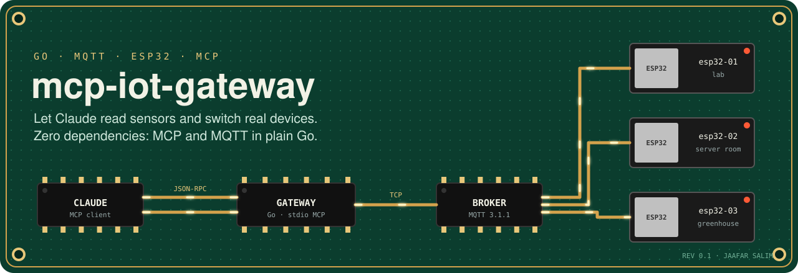
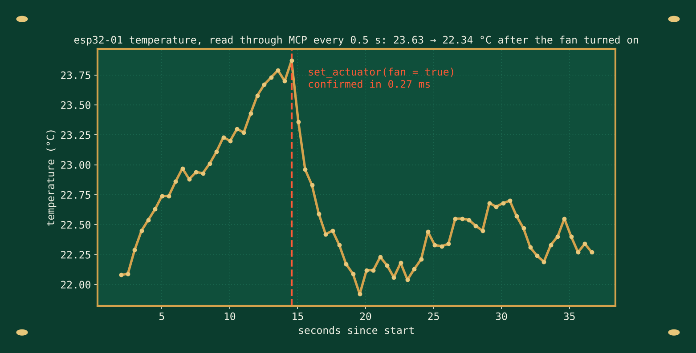
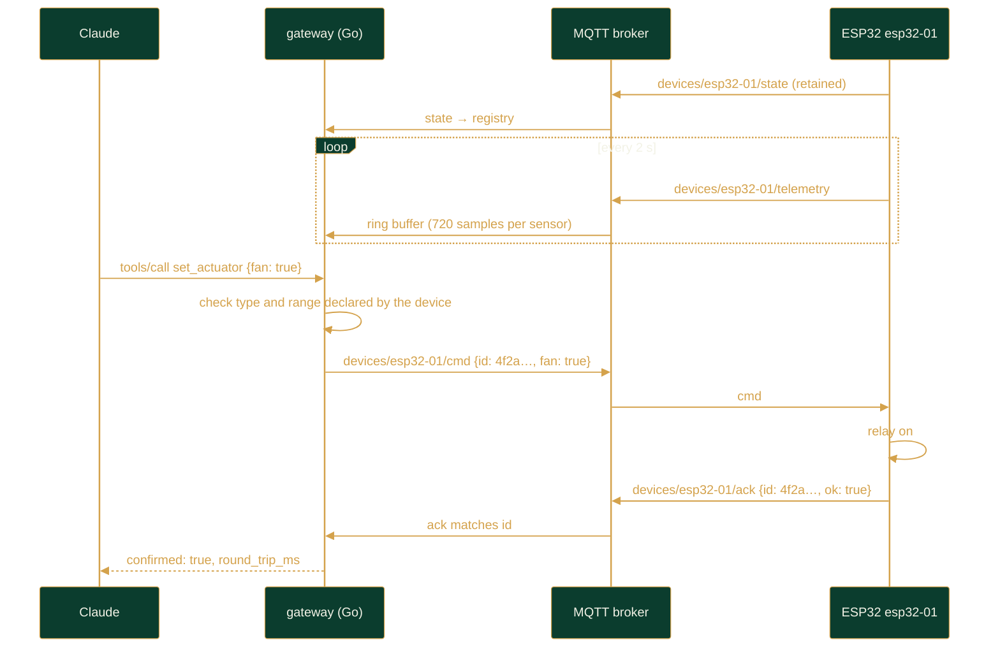
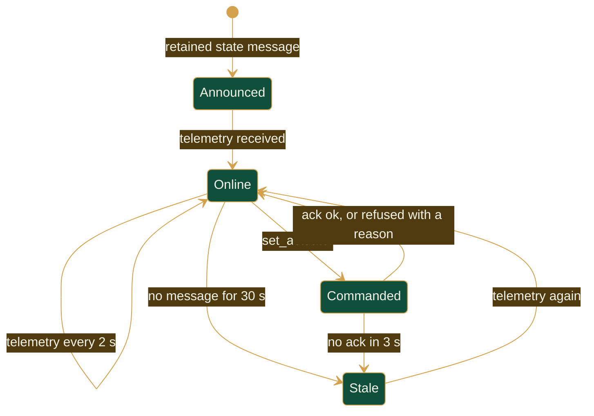
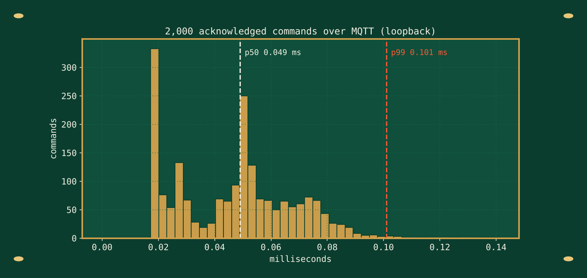
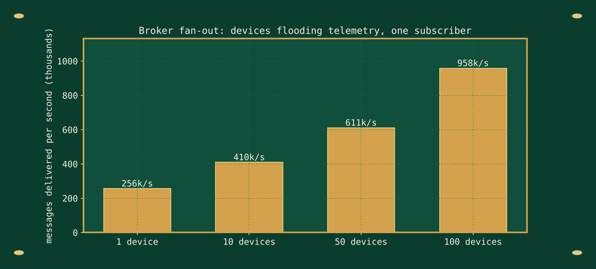

<p align="center"></p>

<p align="center">


</p>

> **"What's the temperature in the lab? If it's above 23 °C, turn the fan on."**
>
> With this gateway, Claude can actually do that. It is a [Model Context Protocol](https://modelcontextprotocol.io) server that sits between Claude and an MQTT network of ESP32 boards: it discovers the devices, reads their sensors, and sends commands that the device has to acknowledge before Claude is told they worked.

<br>

<table>
<tr>
<td width="33%" align="center"><h3>📡 Discover</h3>Devices announce their own sensors and actuators. Plug a board in and it appears in <code>list_devices</code>.</td>
<td width="33%" align="center"><h3>🌡️ Read</h3>Latest value, plus min / mean / max over the last N samples, with units and age.</td>
<td width="33%" align="center"><h3>🔌 Act, safely</h3>Values are checked against the range the device declared, and every command waits for the device's acknowledgement.</td>
</tr>
</table>

---

## ⚡ The 60-second demo (no hardware)

```bash
git clone https://github.com/jafarSalim/mcp-iot-gateway.git
cd mcp-iot-gateway
go build -o bin/gateway ./cmd/gateway     # standard library only: no go get, no go.sum
```

Add it to **Claude Desktop** (`claude_desktop_config.json`), with three simulated ESP32 nodes:

```json
{
  "mcpServers": {
    "iot": { "command": "/path/to/mcp-iot-gateway/bin/gateway", "args": ["-sim", "3"] }
  }
}
```

or to **Claude Code**: `claude mcp add iot -- /path/to/bin/gateway -sim 3`

Then ask: *"List my devices"*, *"What's the humidity trend in the greenhouse?"*, *"Turn the lab fan on."*

### A real session, recorded

[`scripts/demo.py`](scripts/demo.py) drives the gateway with the **official Python MCP SDK client** over stdio, exactly like Claude Desktop would. It read `esp32-01` every half second, switched the fan on after about 13 seconds, and kept reading:

<p align="center"></p>

The average of the last 8 readings fell from **23.63 °C** just before the command to **22.34 °C** at the end. (The simulated node cools by 2.5 °C when its fan runs, on top of a compressed two-minute "day" cycle.)

What the tools returned in that session:

```jsonc
// list_devices  (2.5 ms), first of three devices
{"id": "esp32-01", "name": "Climate node 1", "model": "ESP32-WROOM-32 (simulated)", "location": "lab", "online": true, "last_seen_seconds_ago": 0, "sensors": {"humidity": {"unit": "%RH"}, "temperature": {"unit": "°C"}}, "actuators": {"fan": {"type": "bool"}, "led": {"type": "int", "min": 0, "max": 255}}, "actuator_state": {"fan": false}}
```

```jsonc
// set_actuator {"device_id":"esp32-01","actuator":"fan","value":true}  (0.72 ms)
{"actuator": "fan", "confirmed": true, "device": "esp32-01", "round_trip_ms": 0.27, "value": true}
```

```jsonc
// read_sensor {"device_id":"esp32-01","sensor":"temperature","last_n":20}
{"age_seconds": 0.1, "device": "esp32-01", "sensor": "temperature", "unit": "°C", "value": 22.2, "window": {"max": 22.7, "mean": 22.44, "min": 22.19, "samples": 20, "span_seconds": 9, "values": "… last 6: 22.55, 22.4, 22.27, 22.34, 22.27, 22.2"}}
```

```text
set_actuator {"device_id":"esp32-01","actuator":"led","value":300}  →  isError: esp32-01.led must be between 0 and 255
read_sensor  {"device_id":"esp32-07", ...}                          →  isError: unknown device "esp32-07"; call list_devices to see what is connected
```

Errors are written for the model: they say what was wrong and what to do next.

---

## 🧭 Architecture



A command is only reported as done after the device acknowledges it with the same correlation id. If no acknowledgement arrives within 3 seconds, Claude is told the device may be offline.



### The MQTT protocol

| Topic | Direction | Payload |
|---|---|---|
| `devices/<id>/state` | device → gateway, **retained** | `{"id","name","model","location","sensors":{"temperature":{"unit":"°C"}},"actuators":{"led":{"type":"int","min":0,"max":255}}}` |
| `devices/<id>/telemetry` | device → gateway, every 2 s | `{"temperature":22.94,"humidity":48.2,"fan":false}` |
| `devices/<id>/cmd` | gateway → device | `{"id":"4f2a…","actuator":"fan","value":true}` |
| `devices/<id>/ack` | device → gateway | `{"id":"4f2a…","actuator":"fan","value":true,"ok":true}` |

Any MQTT broker works (Mosquitto, EMQX, HiveMQ) with `-broker host:1883`. Without it, the gateway starts its own.

### The three tools

| Tool | MCP hints | What it does |
|---|---|---|
| `list_devices` | read_only_hint | All devices on the MQTT network, with their sensors, actuators, current actuator state and whether they are online. |
| `read_sensor` | read_only_hint | Latest value of one sensor, and optionally min/mean/max over the last N samples. |
| `set_actuator` | idempotent_hint | Send a command to a device actuator (for example fan=true or led=128) and wait for the device to confirm it. Values are checked against the range the device declares. |

---

## 🔧 With a real ESP32

[`firmware/esp32_node/esp32_node.ino`](firmware/esp32_node/esp32_node.ino) speaks the same protocol as the simulator.

| ESP32 pin | Connects to |
|---|---|
| GPIO 4 | DHT22 data (10 kΩ pull-up to 3.3 V) |
| GPIO 26 | relay module IN (fan) |
| GPIO 2 | LED through 220 Ω (PWM 0–255) |
| 3.3 V / GND | DHT22 supply; power the relay module as its datasheet says |

1. Install the libraries in the Arduino IDE: **PubSubClient**, **ArduinoJson 7**, **DHT sensor library** (Adafruit).
2. Set `WIFI_SSID`, `WIFI_PASS`, `MQTT_HOST` (your computer's IP) and `NODE_ID` at the top of the sketch, and flash it.
3. Run the gateway so boards on your network can reach the broker: `bin/gateway -listen 0.0.0.0:1883`

The board appears in `list_devices` as soon as it connects.

---

## 📊 Measured

[`cmd/bench`](cmd/bench/main.go) runs the broker, five simulated nodes and the gateway in one process (loopback network, one laptop-class CPU).

<p align="center"></p>

| Path | p50 | p90 | p99 |
|---|:---:|:---:|:---:|
| Command round trip: gateway → broker → device → ack → gateway | 0.049 ms | 0.075 ms | 0.101 ms |
| Full MCP `tools/call read_sensor` (JSON-RPC in and out, 60-sample window) | 0.021 ms | 0.033 ms | 0.139 ms |
| Full MCP `tools/call set_actuator` (including the device round trip) | 0.098 ms | 0.115 ms | 0.232 ms |

The gateway adds well under a millisecond. On a real network, Wi-Fi to the ESP32 dominates (typically a few to tens of milliseconds), and Claude's own response takes seconds.

<p align="center"></p>

The embedded broker delivered **958k messages per second** with 100 publishers flooding telemetry. A real ESP32 node sends one message every 2 seconds, so one machine has plenty of headroom.

---

## 🧱 Inside

```text
mcp-iot-gateway/
├── cmd/
│   ├── gateway/         the MCP server (stdin/stdout) + embedded broker + optional simulators
│   └── bench/           latency and throughput benchmark → results/bench.json
├── internal/
│   ├── mcp/             MCP over stdio: initialize, ping, tools/list, tools/call (concurrent calls)
│   ├── mqtt/            MQTT 3.1.1 broker and client: QoS 0, retained messages, + and # wildcards
│   ├── gateway/         device registry, ring buffers, the 3 tools, command/ack correlation
│   └── sim/             simulated ESP32 nodes (same protocol as the firmware)
├── firmware/esp32_node/ Arduino C++ for a real ESP32 with DHT22, relay and LED
├── scripts/             demo.py (official MCP client session), charts.py
└── results/             demo.json, bench.json and the figures
```

```bash
go test ./...                     # broker, wildcards, discovery, range checks, timeouts, MCP protocol over pipes
go run ./cmd/bench                # rewrites results/bench.json
python scripts/demo.py            # needs: pip install mcp, and bin/gateway built
python scripts/charts.py
```

**Why zero dependencies?** The MCP stdio transport is newline-delimited JSON-RPC, and MQTT 3.1.1 at QoS 0 is a handful of packet types. Both fit in about 600 lines of standard-library Go, so `go build` works anywhere and there is nothing to audit but this repository.

## ⚠️ Limits and safety

* QoS 0 only, no TLS and no authentication on the embedded broker: run it on a trusted local network, or point the gateway at a broker that has TLS and passwords.
* No Last Will messages: "online" is derived from the last message (30 s).
* The gateway checks types and ranges, but it cannot know whether switching something is safe in your room. The server instructs Claude to confirm with you before switching anything that could be unsafe; keep dangerous loads off this network.
* The firmware is written against the libraries listed above; it is not compiled by this repository's tests.

---

<p align="center"><b>Eng. Jaafar Salim</b> · University of Technology, Iraq · <a href="https://github.com/jafarSalim">github.com/jafarSalim</a><br>
From a chat message to a relay click. If you build something with it, a ⭐ helps others find it.</p>
